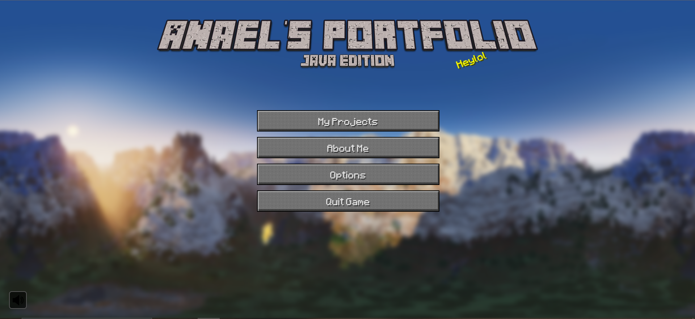
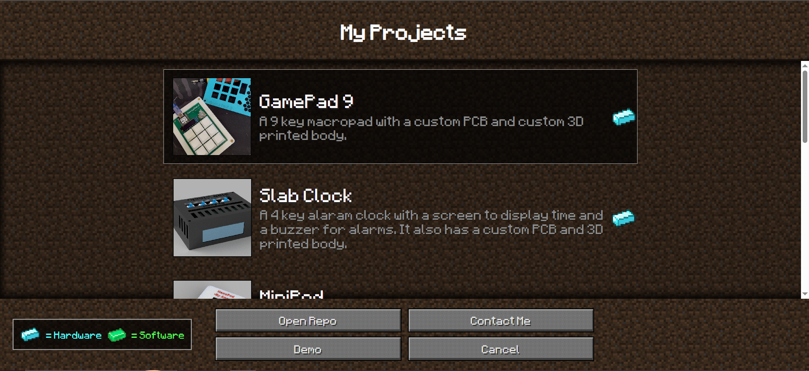
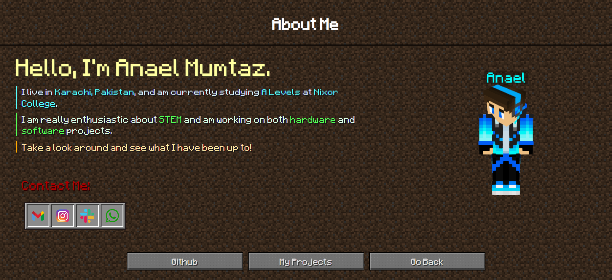

# Portfolio Website 
This project is a personal website for myself. It showcases all my projects and has some cool features aswell. The theme is minecraft cuz I grew up playing it.

Check it out at: [Website](<https://personal-website-ashen-tau-20.vercel.app/index.html>)

## Description
The website is coded in HTML, CSS and Javascript. The details/features of each page are:
1. Homepage: This page is like the Minecraft loading screen with the background music as well. The yellow text is also changed on each reload.
2. Projects Page: While building, I thought to make all my projects as different worlds, so this page showcases all my projects, each being a world. There are buttons to go to the repo/demo as well, and I used diamond and emerald Ingots to specify the project type (hardware/software)
3. About Page: This page is definitely my favourite. It has a short description of me on the left side and a contact bar with my socials which looks exactly like the inventory in Minecraft. On the right side, I rendered an interactive 3D player using skinview3d (repo has the same name). The player's head follows your cursor, and the coolest thing is that the player nods when you hover over the contact bar.
4. Options Page: I haven't made this, but I have big plans for it. I want to add things like paronama selector and music changer.
5. Quit Game: No need for a description!

### Screenshots
Homepage:
 

Projects Page:

About Page:

## Getting Started

### Dependencies

- Any OS that can run a browser.
- Any web browser.
- VS Code (with Live Server extension).
- The website can run on phones, but its UI is not optimized for them yet.

### Installing

- Clone the repo from GitHub. 
- No modifications needed to run it normally.

### Executing program

- Open the folder in VS Code and run it with Live Server.

## AI Usage

I tried my best to avoid AI, but these are the places where it was used:

- The design choices and values, such as the colors of each line, were given by Gemini since I wanted to recreate the Minecraft menu exactly. However, it did not write the CSS directly.
- Help with the final head nodding JavaScript code, such as recommending the use of trigonometric functions to make the motion smooth.
- Code debugging.

## Future plans
This is the start of this project. I have so many ideas and easter eggs in mind, and I plan on adding all of them in the future. 

## License

This project is licensed under the MIT License.

## Note 
This project is made in HackClub Crossroads.

